# SQL_ADVANCED 6주차 정규 과제 

📌SQL_ADVANCED 정규과제는 매주 정해진 분량의 『*혼자 공부하는 SQL*』 을 읽고 학습하는 것입니다. 이번주는 아래의 **SQL_ADVANCED_6th_TIL**에 나열된 분량을 읽고 공부하시면 됩니다.

아래의 문제를 풀어보며 학습 내용을 점검하세요. 문제를 해결하는 과정에서 개념을 스스로 정리하고, 필요한 경우 제시된 강의를 참고하여 보완하는 것이 좋습니다.

<!-- 강의 링크는 아래와 같습니다.
https://www.youtube.com/watch?v=cw1wGN0ZdFA&list=PLVsNizTWUw7GCfy5RH27cQL5MeKYnl8Pm&index=19
https://www.youtube.com/watch?v=bMQ_dAoaMzA&list=PLVsNizTWUw7GCfy5RH27cQL5MeKYnl8Pm&index=20
https://www.youtube.com/watch?v=bggWVsBmKag&list=PLVsNizTWUw7GCfy5RH27cQL5MeKYnl8Pm&index=21
-->

**교재 실습 예제 파일은 08_SQL_ADVANCED_Template 레포지토리의 src 폴더에 업로드되어 있습니다. market_db 파일도 해당 폴더에 함께 포함되어 있으니 참고하시기 바랍니다.**

**👀(수행 인증샷은 필수입니다.)** 

## SQL_ADVANCED_6th_TIL

### 7장 스토어드 프로시저
#### 01. 스토어드 프로시저 사용 방법
#### 02. 스토어드 함수와 커서
#### 03. 자동 실행되는 트리거 


## Study Schedule

| 주차  | 공부 범위     | 완료 여부 |
| ----- | ------------- | --------- |
| 1주차 | p.24~99    | ✅         |
| 2주차 | p.102~155   | ✅         |
| 3주차 | p.158~213  | ✅         |
| 4주차 | p.216~271 | ✅         |
| 5주차 | p.274~327 | ✅         |
| 6주차 | p.330~369 | ✅         |
| 7주차 | p.372~407 | 🍽️         |


<br>

<!-- 여기까진 그대로 둬 주세요-->

---

# 1️⃣ 학습 내용 정리

## 1. 스토어드 프로시저 사용 방법 

- **스토어드 프로시저**는 MySQL에서 제공하는 프로그래밍 기능으로, 여러 SQL 문을 하나로 묶어 저장해 두고 `CALL 프로시저_이름()`으로 실행합니다. 자주 쓰는 쿼리를 매번 다시 입력하지 않아도 됩니다.
- 기본 형식
  ```sql
  DELIMITER $$
  CREATE PROCEDURE 프로시저_이름(IN 또는 OUT 매개변수)
  BEGIN
      -- SQL 프로그래밍 코드
  END $$
  DELIMITER ;
  ```
  - `DELIMITER $$`로 구분자를 바꿔야 프로시저 안의 `;`가 문장의 끝으로 처리되지 않습니다. 작성이 끝나면 `DELIMITER ;`로 되돌립니다.
  - 삭제는 `DROP PROCEDURE 프로시저_이름;`이며, 이때는 괄호를 붙이지 않습니다.
- **매개변수**
  - `IN 변수명 데이터형식`: 입력 매개변수입니다. `CALL user_proc1('에이핑크')`처럼 값을 넘기고, 여러 개도 받을 수 있습니다.
  - `OUT 변수명 데이터형식`: 출력 매개변수입니다. 프로시저 안에서 `SELECT ~ INTO`로 값을 넣고, 호출할 때 `@변수`로 받습니다.
- 프로시저 안에서는 `DECLARE`로 변수를 선언하고 `IF ~ ELSE`, `WHILE` 같은 흐름 제어를 쓸 수 있습니다.
- `PREPARE ~ EXECUTE`를 함께 쓰면 테이블 이름처럼 실행 시점에 정해지는 값으로 **동적 SQL**을 만들 수 있습니다.
- 프로시저는 서버에 저장되므로 SQL 문 전체 대신 `CALL` 한 줄만 보내면 됩니다. 그래서 네트워크 부하가 줄고, 사용자에게 테이블 대신 프로시저 권한만 주면 보안에도 유리합니다.

**실습 인증**

① `IN` 매개변수 1개: `user_proc1('에이핑크')` 실행 결과

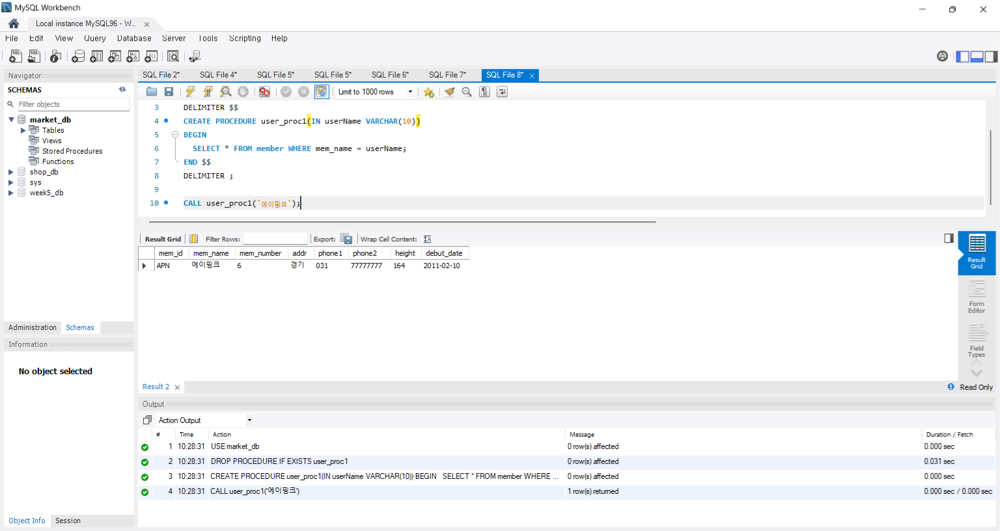

② `IN` 매개변수 2개: 인원이 6명 초과이고 키가 165 초과인 그룹 조회

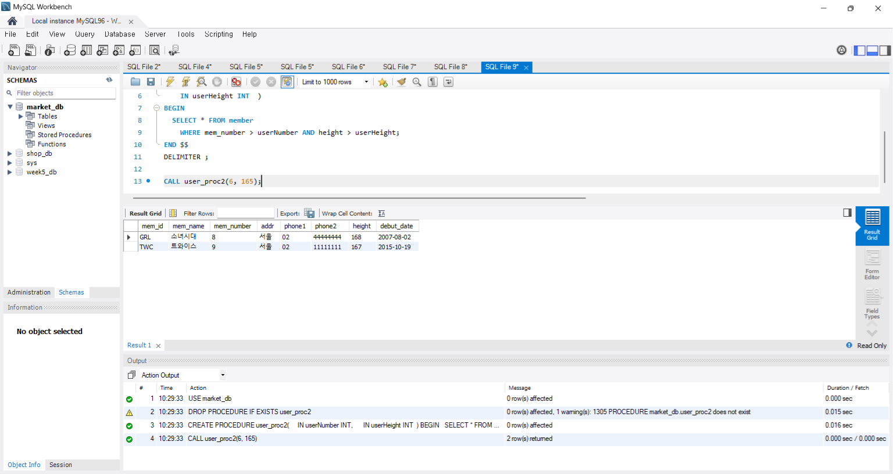

③ `OUT` 매개변수: `noTable`에 데이터를 넣고, 입력된 ID 값을 `@myValue`로 받기

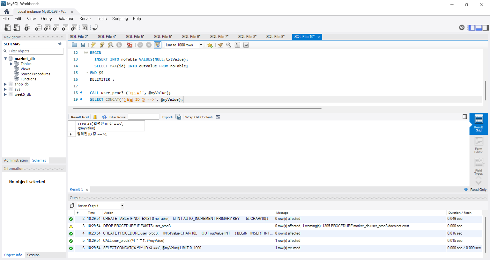

④ `IF ~ ELSE`: 데뷔 연도가 2015년 이후면 신인 가수로 판별 (오마이걸 → 신인 가수)

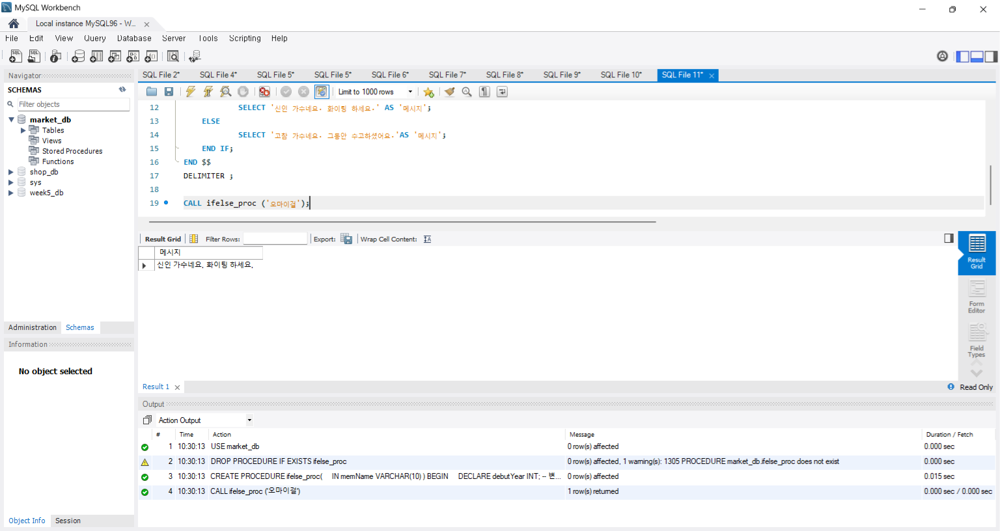

⑤ `WHILE`: 1부터 100까지의 합계 = 5050

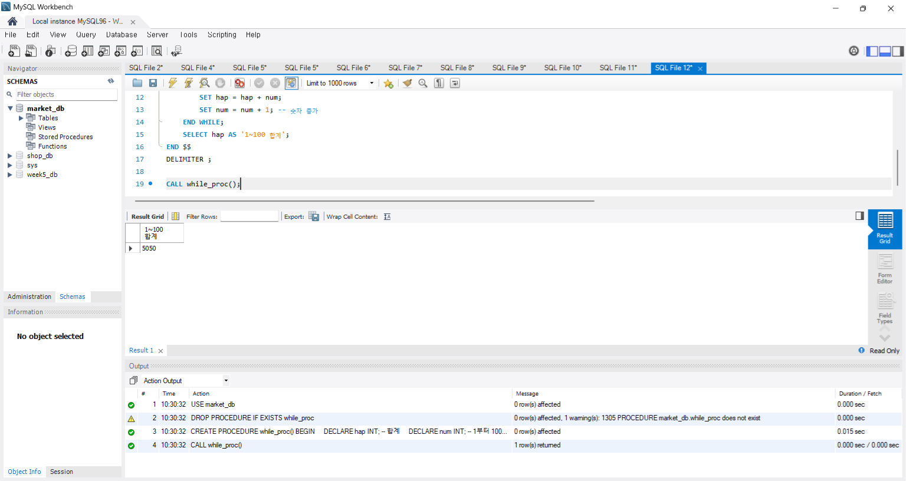

⑥ 동적 SQL: 테이블 이름을 매개변수로 받아 `PREPARE`/`EXECUTE`로 조회

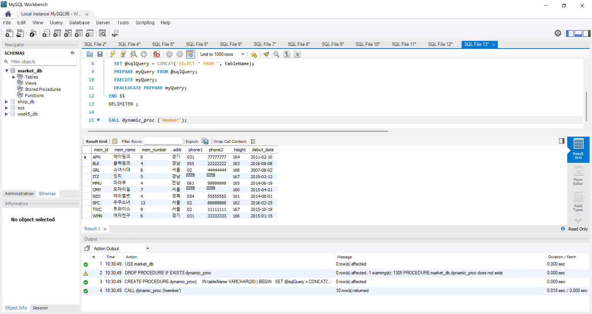


## 2. 스토어드 함수와 커서 

- **스토어드 함수**는 `SUM()`, `CONCAT()` 같은 내장 함수 외에 사용자가 직접 만들어 쓰는 함수입니다.
  ```sql
  DELIMITER $$
  CREATE FUNCTION 함수_이름(매개변수)
      RETURNS 반환형식
  BEGIN
      -- 프로그래밍 코드
      RETURN 반환값;
  END $$
  DELIMITER ;
  ```
- 스토어드 프로시저와의 차이
  - 매개변수에 `IN`/`OUT`을 쓰지 않으며, 모든 매개변수가 입력용입니다.
  - `RETURNS`로 반환 형식을 지정하고, 본문에서 `RETURN`으로 **값 하나**를 돌려줍니다.
  - `CALL`이 아니라 `SELECT` 문 안에서 호출합니다. 그래서 `SELECT mem_id, calcYearFunc(YEAR(debut_date)) FROM member;`처럼 조회 결과의 열 계산에 바로 쓸 수 있습니다.
  - 함수 안에서는 `SELECT` 문으로 결과 집합을 돌려줄 수 없습니다.
- 함수를 만들기 전에 `SET GLOBAL log_bin_trust_function_creators = 1;`로 함수 생성 권한을 허용해야 합니다.
- **커서**는 테이블의 행을 한 줄씩 차례대로 처리할 때 씁니다. 순서는 다음과 같습니다.
  1. 커서 선언 (`DECLARE 커서명 CURSOR FOR SELECT ...`)
  2. 반복 조건 선언 (`DECLARE CONTINUE HANDLER FOR NOT FOUND SET endOfRow = TRUE;` → 더 읽을 행이 없으면 반복을 끝냄)
  3. 커서 열기 (`OPEN`)
  4. 반복하며 한 행씩 가져오기 (`LOOP` 안에서 `FETCH ... INTO`, 끝이면 `LEAVE`)
  5. 커서 닫기 (`CLOSE`)

**실습 인증**

① 두 수를 더하는 `sumFunc(100, 200)` = 300

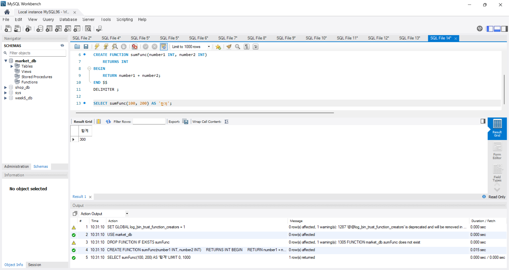

② 데뷔 연도로 활동 햇수를 구하는 `calcYearFunc`를 `SELECT` 문 안에서 회원별로 사용

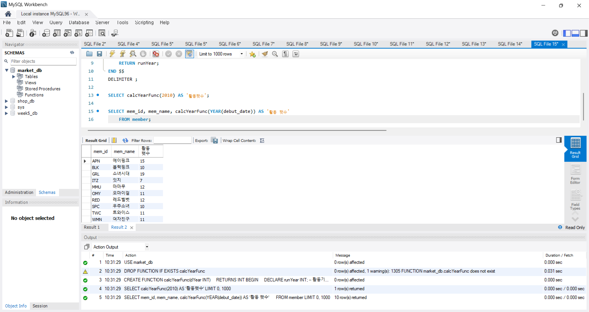

③ 커서로 회원 테이블을 한 행씩 읽어 회원의 평균 인원 수 계산 (= 6.4)

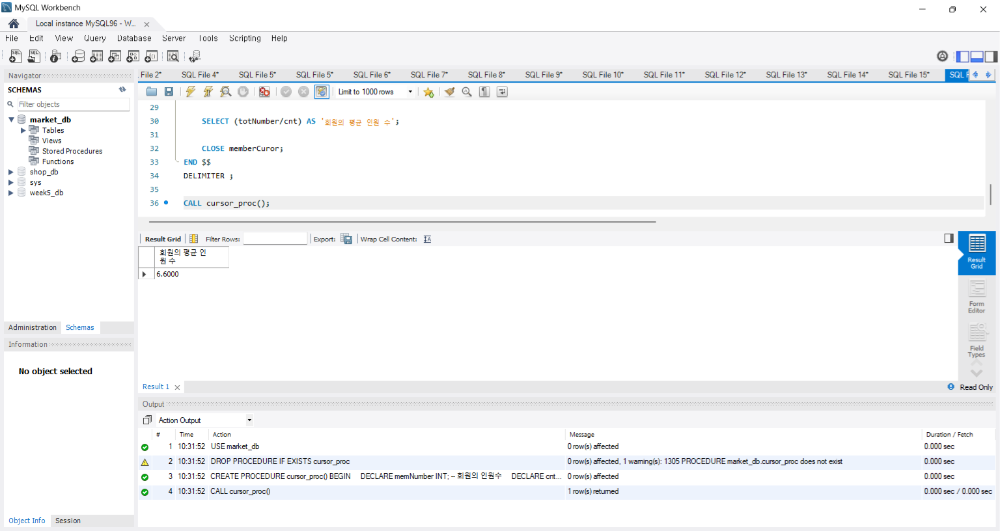


## 3. 자동 실행되는 트리거 

- **트리거**는 테이블에 `INSERT`, `UPDATE`, `DELETE` 작업이 일어나면 자동으로 실행되는 코드입니다. 데이터가 삭제되거나 수정될 때 이전 데이터를 따로 남기는 등 **데이터 무결성**을 지키는 데 쓰입니다.
- 스토어드 프로시저와 문법이 비슷하지만 `CALL`로 직접 실행할 수 없고, 테이블에 부착되어 이벤트가 발생할 때만 동작합니다.
  ```sql
  DELIMITER $$
  CREATE TRIGGER 트리거_이름
      AFTER DELETE          -- AFTER/BEFORE + INSERT/UPDATE/DELETE
      ON 테이블_이름
      FOR EACH ROW          -- 각 행마다 적용
  BEGIN
      -- 트리거가 실행될 때 작동할 코드
  END $$
  DELIMITER ;
  ```
- 실습에서 `myTrigger`는 `AFTER DELETE`로 만들었습니다. 그래서 `INSERT`와 `UPDATE` 뒤에는 `@msg`가 빈 값이었고, `DELETE` 뒤에만 '가수 그룹이 삭제됨'이 들어갔습니다.
- 트리거 안에서는 임시 테이블 **`OLD`**와 **`NEW`**를 쓸 수 있습니다.
  - `NEW`: `INSERT`/`UPDATE` 시 새로 들어갈 값이 잠깐 저장됩니다.
  - `OLD`: `UPDATE`/`DELETE` 시 변경·삭제되기 전의 값이 잠깐 저장됩니다.
  - 그래서 `AFTER UPDATE`/`AFTER DELETE` 트리거에서 `OLD.mem_id` 등을 백업 테이블에 넣으면 누가, 언제, 무엇을 바꿨는지 기록할 수 있습니다.
- **`TRUNCATE TABLE`로 행을 지우면 `DELETE` 트리거가 동작하지 않습니다.** `TRUNCATE`는 DML이 아닌 DDL이기 때문입니다.

**실습 인증**

① `AFTER DELETE` 트리거: 삭제 후에만 `@msg`에 메시지가 들어감

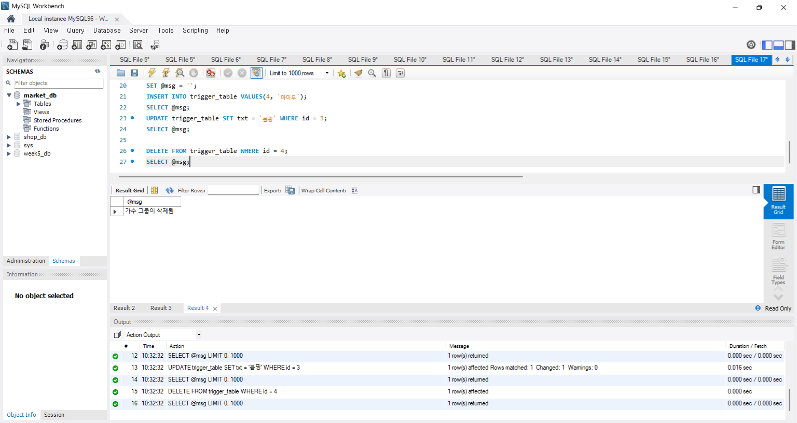

② `singer` 테이블의 수정·삭제 내역이 `OLD` 테이블을 통해 `backup_singer`에 자동 저장됨 (수정 1건, 삭제 4건)

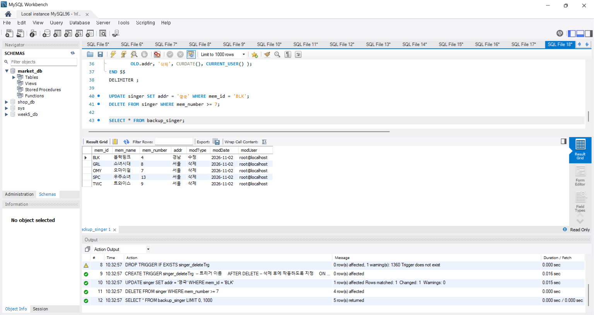

③ `TRUNCATE TABLE singer` 후에도 `backup_singer`는 그대로 5건 → `TRUNCATE`에는 `DELETE` 트리거가 동작하지 않음

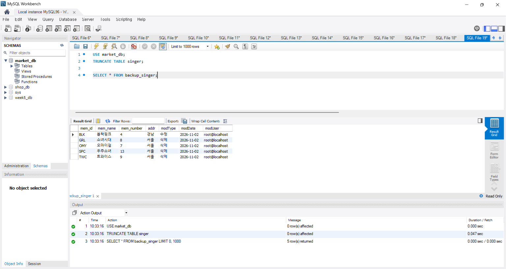


---


### 🎉 수고하셨습니다.
